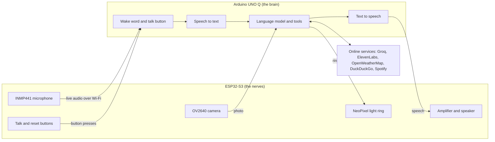

# THEO - AI Voice Assistant for Elderly Tech Support (Technical Help, Explanations, and Optimization)

## Overview

THEO is an intelligent voice-controlled personal assistant designed specifically to help older adults with everyday technology challenges. The assistant combines speech recognition, natural language processing, computer vision, internet search, media control, task management and personal memory into a single easy-to-use device.

THEO is built from two boards that work together over Wi-Fi. An **Arduino UNO Q** is THEO's **brain**: it runs the AI, the tools, the voice and the memory. An **ESP32-S3** is THEO's **nerves**: it drives the hardware, including the microphone, camera, speaker, light ring and buttons.

Unlike traditional voice assistants, THEO focuses on providing simple, clear, and non-technical support for users who may have limited technological experience.

This README describes THEO update **2026-10-25.1**. Setup instructions are in [SETUP.md](SETUP.md).

## Project Goal

The primary goal of THEO is to make technology more accessible to elderly users by providing a voice-first interface that reduces reliance on keyboards, touchscreens, and technical knowledge. By combining AI-powered assistance with simple communication, THEO helps bridge the gap between modern technology and users who may find it difficult to navigate.

## Features

### Wake Word Detection

* Hands-free activation using the wake phrase **"Hey THEO"**, detected on the device with a custom openWakeWord model
* Talk button that makes THEO start listening straight away, without the wake phrase
* Pressing the talk button while THEO is thinking or speaking stops the answer
* Follow-up questions for 15 seconds after an answer, without repeating the wake phrase
* While music is playing, THEO only responds when it hears its name
* For training your own custom wakeword models, I recommend using the free colab notebook by the creator of openwakeword: https://colab.research.google.com/drive/1q1oe2zOyZp7UsB3jJiQ1IFn8z5YfjwEb#scrollTo=qgaKWIY6WlJ1 (fixes for running it on Python 3.13 are in [SETUP.md](SETUP.md#9-training-your-own-wake-word))

### Speech Recognition

* Online transcription using Groq's Whisper Large v3 Turbo model
* Automatic offline fallback using Faster-Whisper, running on the UNO Q
* A hint of local names and places, plus names THEO has remembered, helps it hear names like "Half Way Tree" correctly
* Seamless transition between online and offline modes

### Text-to-Speech Responses

* High-quality online voice synthesis through ElevenLabs
* Offline voice generation using Kokoro ONNX
* Automatic switch to the offline voice if ElevenLabs fails twice in a row
* Adjustable speaking speed and volume: "speak more slowly", "speak faster", "louder" and "quieter", saved across restarts
* "Say that again" repeats THEO's last answer or reminder

### Online and Offline Operation

THEO automatically detects internet availability and adapts its functionality:

**Online Mode**

* Groq LLM (GPT-OSS 120B) with tool use
* Groq Whisper transcription
* ElevenLabs speech synthesis
* Weather information
* Web search
* Spotify music
* Error screen analysis

**Offline Mode**

* Ollama local language model (Llama 3.2 1B by default)
* Faster-Whisper transcription
* Kokoro speech synthesis
* Time, timers, reminders and personal memory
* Basic help/advice, reliant on the local model

If Groq fails or takes longer than 20 seconds, THEO answers with the local models and tries Groq again a minute later. The light ring turns blue while THEO is offline.

### ☁️ Weather Information

* Retrieves real-time weather conditions from OpenWeatherMap
* Reports temperature and weather descriptions
* Supports any city worldwide, with Kingston, Jamaica as the default location

### 🎵 Spotify Voice Control

Control Spotify entirely through voice commands, played through THEO's own speaker:

* Play songs by name and artist, or ask for a mood such as "something calm"
* Pause and resume playback
* Skip tracks
* Return to previous tracks

THEO appears in Spotify as a speaker called **THEO**. A small bridge on the UNO Q streams the music to the ESP32-S3, and the music pauses while THEO listens and answers.

### Timers and Reminders

* Create countdown timers and one-off reminders, such as "in 10 minutes"
* Set recurring reminders every so many minutes
* Set reminders at a time of day, once or every day, kept across restarts
* Medicine reminders: THEO asks whether the medicine was taken, understands yes or no (including some Jamaican Patois), and asks again 10 minutes later if needed, up to three more times
* Cancel existing reminders, or ask which reminders are set
* Audio notifications when reminders expire, and the light ring breathes amber until someone speaks to THEO

### Personal Memory

* Remembers useful details about the user, such as family names, their phone and other devices, health needs and likes
* Recalls notes when asked ("what do you remember about me?") and forgets them on request
* Only the notes that fit each question are sent with it, so a large memory stays quick

### Internet Search

* Voice-powered web searching
* Results fetched through DuckDuckGo, using the `ddgs` library with no API key needed
* Retrieves and summarizes the top search results
* Provides quick answers to user questions

### Computer Error Analysis

A unique accessibility feature designed for non-technical users.

THEO can:

1. Understand when the user wants to show their error
2. Ask them to hold the screen up to the camera, with a five-second countdown
3. Glow a soft white pulse on the light ring during the countdown and capture
4. Capture an image automatically with the ESP32-S3's camera
5. Analyze the error using a multimodal AI model
6. Explain the issue in simple language, or ask the user to hold the screen closer if it is too blurry to read

### Memory Reset and Onboarding

A separate memory-reset button lets THEO start fresh for a new user.

* Hold the reset button for five seconds; short presses are ignored
* Clears remembered notes, the conversation, timers and reminders, voice preferences, and the last photo and recording
* Keeps Wi-Fi, API keys, sign-ins and model files

After a reset, THEO introduces himself with a spoken welcome:

1. Explains who he is and what he can help with
2. Reminds the user that he can speak more slowly or faster whenever they need
3. Asks what name they would like him to use
4. Asks what they find difficult about their phone or other technology
5. Remembers their answers and reassures them that he can help, one step at a time

The user can say "skip" to either question, and an unfinished welcome carries on after a restart.

### Light Ring Feedback

A 16-light NeoPixel ring shows what THEO is doing:

| State | Ring |
|---|---|
| Waiting | Dark |
| Listening | Fills around the ring with the user's voice |
| Thinking | A point of light travels around the ring |
| Speaking | Light blooms with each word |
| Taking a picture | Soft white pulse |
| Reminder | Breathes amber until someone speaks to THEO |
| Offline | Blue |

### Elderly-Friendly Design

* Short responses (maximum two sentences)
* Simple instructions
* Minimal technical terminology
* One-step-at-a-time guidance
* Conversational interaction, written to be spoken aloud
* Physical buttons to talk, to stop an answer and to start fresh
* THEO never says it has set a reminder or remembered something unless it actually did

---

## Hardware

| Part | Role |
|---|---|
| **Arduino UNO Q (4 GB)** | **The brain.** Runs THEO's Python app in Arduino App Lab: wake word, speech recognition, language models, tools, voice, memory and reminders. Also runs the Spotify bridge. |
| **ESP32-S3 (N16R8)** | **The nerves.** Drives the microphone, camera, speaker, light ring and buttons, and streams sound to and from the UNO Q over Wi-Fi. |
| INMP441 I2S microphone | Hears the user |
| OV2640 camera | Photographs screens |
| 8002B amplifier and speaker | THEO's voice and music |
| Adafruit NeoPixel Ring 16 | Shows what THEO is doing |
| Two push buttons | Talk/stop, and memory reset |

Wiring and power details are in [SETUP.md](SETUP.md#2-wire-the-esp32-s3).

The current build is the breadboard prototype, THEO v0. THEO v1, with its own circuit board, enclosure and a MAX98357A amplifier for clearer sound, is in progress.

---

## System Architecture



### Input Layer

* Wake word detection (OpenWakeWord, on the UNO Q)
* Live microphone audio from the INMP441, streamed by the ESP32-S3 over Wi-Fi
* Talk button and memory-reset button on the ESP32-S3
* Camera capture (OV2640 camera on the ESP32-S3)

### Processing Layer

* Speech-to-text conversion
* Language model reasoning
* Tool selection and execution
* Computer vision analysis
* Memory, reminders and onboarding progress saved on the UNO Q

### Output Layer

* Text-to-speech generation
* Audio playback through the ESP32-S3's speaker, for THEO's voice and Spotify music
* Light-ring status feedback
* Notifications and alarms

---

## Technologies Used

### Artificial Intelligence

* Groq API
* GPT-OSS 120B (`openai/gpt-oss-120b`), the online language model
* Qwen vision model (`qwen/qwen3.8-27b`), which reads photographed screens
* Whisper Large v3 Turbo (`whisper-large-v3-turbo`), on Groq
* Faster-Whisper
* Ollama, with Llama 3.2 1B (`llama3.2:1b`)
* OpenAI Compatible API, used to reach Ollama

### Speech Processing

* OpenWakeWord 0.4.0, with a custom "Hey THEO" model
* ElevenLabs (Flash v2.5)
* Kokoro ONNX
* Silero voice activity detection

### Computer Vision

* OV2640 camera on the ESP32-S3
* Base64 Image Encoding

### Hardware and Firmware

* Arduino UNO Q, running Arduino App Lab
* ESP32-S3 firmware built with the Arduino IDE and the ESP32 boards package
* INMP441 microphone, 8002B amplifier and Adafruit NeoPixel Ring 16

### External Services

* OpenWeatherMap API
* Spotify Web API, with Spotify Connect through librespot
* DuckDuckGo Search

### Python Libraries

* groq
* openai
* python-dotenv
* requests
* httpx
* numpy
* scipy
* soundfile
* faster-whisper
* kokoro-onnx
* elevenlabs
* openwakeword
* spotipy
* ddgs

---

## Repository Contents

| File | Runs on | Purpose |
|---|---|---|
| `main.py` | UNO Q, in App Lab | THEO's main program |
| `theo_node.py` | UNO Q, in App Lab | The connection to the ESP32-S3: live microphone, buttons, speech and camera |
| `theo_onboarding.py` | UNO Q, in App Lab | Memory reset and the spoken welcome |
| `find_node.py` | UNO Q, in App Lab | Finds the ESP32-S3 on the local network |
| `theo_esp32_node.ino` | ESP32-S3 | Firmware for the microphone, camera, speaker, light ring and buttons |
| `theo_spotify_bridge.py`, `install_theo_spotify.sh` | UNO Q, outside App Lab | Spotify playback through THEO's speaker |
| `spotify_login.py` | A computer with a web browser | One-time Spotify sign-in |
| `alarm_sound.wav` | UNO Q | Optional custom alarm sound |
| `SETUP.md` | | Setup instructions |

---

## Installation

Full setup instructions are in **[SETUP.md](SETUP.md)**. In short:

1. Wire the ESP32-S3 and upload `theo_esp32_node.ino` with the Arduino IDE
2. Put the Python files and model files in THEO's app on the UNO Q, and install the Python libraries
3. Add your API keys to a `key.env` file next to `main.py`
4. Optionally set up Ollama for offline answers and the Spotify bridge for music

---

## Running THEO

Power the ESP32-S3, then start THEO's app in Arduino App Lab on the UNO Q. Switch on **Run at startup** in App Lab to start THEO whenever the UNO Q is powered. THEO finds the ESP32-S3 on the network by itself.

When THEO is ready, the App Lab output shows:

```text
[THEO] Update: 2026-10-25.1
```

THEO will begin listening for the wake word:

```text
"Hey THEO"
```

After activation, or a press of the talk button, simply speak your request.

---

## Example Commands

### General Questions

```text
Hey THEO, what time is it?
```

```text
Hey THEO, what's the weather in Kingston?
```

### Music Control

```text
Hey THEO, play Shape of You by Ed Sheeran.
```

```text
Hey THEO, play something calm.
```

```text
Hey THEO, pause the music.
```

```text
Hey THEO, skip this song.
```

### Timers

```text
Hey THEO, set a timer for 10 minutes.
```

### Reminders

```text
Hey THEO, remind me to take my medication in 3 hours.
```

```text
Hey THEO, remind me to take my tablets at 8 every morning.
```

```text
Hey THEO, cancel my medication reminder.
```

### Memory

```text
Hey THEO, remember that my granddaughter is called Keisha.
```

```text
Hey THEO, what do you remember about me?
```

### Speaking Speed

```text
Hey THEO, speak more slowly.
```

```text
Hey THEO, say that again.
```

### Web Search

```text
Hey THEO, search for the latest news about Jamaica.
```

### Technical Support

```text
Hey THEO, I'm getting an error on my computer.
```

THEO will ask the user to hold the screen up to the camera, count down while the light ring pulses white, and then provide a simplified explanation of the problem.

### Starting Fresh

Hold the memory-reset button for five seconds. THEO clears the previous user's memory and begins his welcome:

```text
Hello, I'm THEO, your Technical Help, Explanations and Optimization assistant.
```
